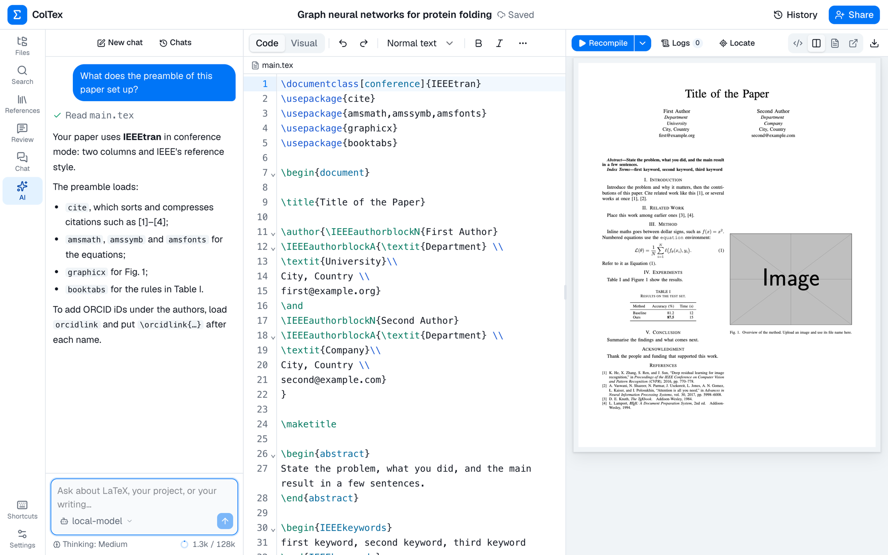

<h1 align="center">ColTex</h1>
<p align="center">
  <strong>自行架設的多人協作 LaTeX 編輯器，內建 AI 代理。</strong><br>
  你的伺服器 · 你的帳號 · 你的資料 · 即時協作 · 開放原始碼（AGPL-3.0）
</p>

<p align="center">
  <a href="../README.md"><kbd>English</kbd></a>
  <a href="./zh-CN.md"><kbd>简体中文</kbd></a>
  <a href="./zh-TW.md"><kbd><b>繁體中文</b></kbd></a>
  <a href="./ja.md"><kbd>日本語</kbd></a>
  <a href="./ko.md"><kbd>한국어</kbd></a>
  <a href="./es.md"><kbd>Español</kbd></a>
  <a href="./fr.md"><kbd>Français</kbd></a><br>
  <a href="./de.md"><kbd>Deutsch</kbd></a>
  <a href="./pt-BR.md"><kbd>Português (Brasil)</kbd></a>
  <a href="./it.md"><kbd>Italiano</kbd></a>
  <a href="./ru.md"><kbd>Русский</kbd></a>
  <a href="./tr.md"><kbd>Türkçe</kbd></a>
  <a href="./vi.md"><kbd>Tiếng Việt</kbd></a>
  <a href="./id.md"><kbd>Bahasa Indonesia</kbd></a>
</p>
<p align="center">
  <a href="#install">安裝</a> · <a href="#configure">設定</a> · <a href="../CHANGELOG.md">更新紀錄</a> · <a href="https://github.com/Lewen-Cai/coltex/issues">Issues</a>
</p>
<p align="center">
  <a href="https://github.com/Lewen-Cai/coltex/releases/latest"></a>
  <a href="../LICENSE"></a>
  <a href="https://github.com/Lewen-Cai/coltex/actions/workflows/ci.yml"></a>
</p>

<a id="quick-start"></a>
## 快速開始

你需要一台裝有 Docker 的 Linux 或 macOS 電腦（在 Linux 上，安裝程式可以代為安裝 Docker），至少 2 個 CPU 核心和 4 GB 記憶體。映像檔已針對 x86-64 和 ARM64 預先建置。

```sh
curl -fsSL https://raw.githubusercontent.com/Lewen-Cai/coltex/main/install.sh | bash
```

然後開啟 `http://<伺服器>:3690`，建立管理員帳號。

<p align="center">
  
</p>

<a id="why"></a>
## 為什麼選擇 ColTex？

ColTex 是 Overleaf 的替代方案，適合研究團隊、實驗室或個人使用，執行在你自己掌控的電腦上：實驗室的桌上型電腦、家中的伺服器或雲端主機都可以。

- **所有資料都留在你的伺服器上。** 專案、版本記錄、帳號和編譯工作都不會離開它。TeX 在無法連上網際網路的沙箱容器中執行。
- **為共同撰寫而設計。** 多人可以同時編輯同一個檔案，並有註解、追蹤修訂、聊天和版本記錄。
- **直接處理你專案的 AI 代理。** 它會閱讀檔案和編譯記錄檔、起草修改、試編譯，再把差異呈現給你。在你套用之前，什麼都不會寫入。
- **一個指令即可安裝，不需要開放連接埠。** 內建 Tailscale 和 Cloudflare Tunnel，方便遠端存取。

<a id="features"></a>
## 功能

### 撰寫與編譯
- 原始碼編輯器（CodeMirror）和視覺化編輯器，包含 Overleaf 的表格編輯器與插圖對話框、工具列、符號面板、大綱和路徑導覽。
- LaTeX 自動完成、語法檢查、公式預覽、多語言拼字檢查、字數統計、整個專案的搜尋與取代，以及 Vim 或 Emacs 按鍵配置。
- 在完整的 TeX Live 上以 latexmk 編譯。引擎（pdfLaTeX、XeLaTeX 或 LuaLaTeX）會依文件自動選擇，包括中文（ctex、xeCJK）。
- PDF 預覽支援雙向 SyncTeX，也可以在獨立視窗中開啟。編譯錯誤會在原始碼中加上底線，並附上淺顯易懂的提示。
- 參考文獻：從你的 `.bib` 檔案引用，搜尋 Crossref 和 arXiv（或貼上 DOI、arXiv 編號）來新增條目，或匯入 Zotero 的文獻庫或分類並保持同步。

### 協作
- 即時編輯並顯示每個人的游標，支援 @提及 的註解、追蹤修訂（接受、拒絕，以及復原已做的決定）、專案聊天和站內通知。
- 每個專案的角色：擁有者、編輯者、審閱者（只能提出建議）和檢視者。
- 像 git 一樣的版本記錄：自動保存的版本、附說明手動儲存的版本，以及撤銷某個版本的變更。
- Git 存取：clone 專案、在本機處理，再 push 回來（使用個人權杖；在這段期間於瀏覽器中所做的編輯會自動合併）。

### AI 代理
- 詢問 LaTeX、你的專案或寫作上的問題，或讓它修正編譯錯誤。它會在私人副本中起草修改、試編譯並顯示差異；你可以全部或部分套用。
- 套用前會先儲存一個版本並重新編譯；如果編譯結果變差，變更會自動復原。
- 供應商：API 金鑰（Anthropic、OpenAI、DeepSeek、Google、OpenRouter 等）、訂閱帳號登入（Claude Pro/Max、ChatGPT、GitHub Copilot 等），或你自己的 OpenAI 相容伺服器（Ollama、vLLM、LM Studio）。
- 自動選擇模型（每則訊息選用輕量或強力模型）、依群組設定存取權限、依人統計用量，以及每天、每週或每月的用量上限。
- 依專案保存對話，即時顯示上下文視窗的使用量，並可用 `/compact` 摘要過長的對話。
- Skill：AI 代理會遵循的個人指示（Agent Skills 格式），所有專案通用，以 `/name` 使用；可以自己撰寫、匯入，或在設定中與 AI 一起建立。
- 與 Claude Code 類似的權限：AI 代理的修改等你審閱（手動）、完成時自動套用（自動），或還可以刪除和移動檔案（完整存取）。
- 透過 MCP 連接你自己的代理（Claude Code、Codex、Cursor…）：所有專案共用一個位址，權限相同（手動模式下，它的編輯會成為你的修改建議）。

### 專案與管理
- IEEE、ACM、Springer LNCS、Elsevier、REVTeX 和 arXiv 範本，以及將論文從一種期刊範本轉換為另一種。
- Overleaf zip 匯入與匯出、來自網址或其他專案的連結檔案、標籤、封存和垃圾桶。
- 沒有公開註冊：帳號只能透過邀請連結建立。一位系統管理員，以及各自管理所邀請團隊的管理員。
- 監控、WebDAV 備份（可選擇加密）、本機或 S3 相容儲存空間、淺色與深色主題，以及 14 種語言的介面（英文、中文（簡體與繁體）、日文、韓文、西班牙文、法文、德文、葡萄牙文、義大利文、俄文、土耳其文、越南文和印尼文）。
- 帳號安全：可用驗證器應用程式開啟兩步驟驗證；登入紀錄顯示每次登入的位址和所在地（在伺服器上查詢）；防止猜密碼，陌生位址多次失敗後鎖定帳號。都不依賴第三方服務。

<a id="install"></a>
## 安裝

如果下載中斷（`curl: (35) Recv failure: Connection reset by peer`，連線 GitHub 不穩定時常見），再執行一次指令即可。

它會詢問語言和 TeX Live 版本（用方向鍵選擇），把最新版本下載到 `~/coltex`，以進度條下載預先建置的映像檔，啟動 ColTex，並列出要開啟的網址。完整輸出會寫入 `~/coltex/install.log`。接著開啟 `http://<server>:3690`，建立管理員帳號。遠端存取（Tailscale、Cloudflare Tunnel）之後在 **設定 → 網路** 中開啟。

第一次啟動會下載 TeX Live。請選擇版本：

| 版本 | 下載量 | 磁碟占用（整個 ColTex） | 建議可用空間 |
| --- | --- | --- | --- |
| **standard**（預設） | 約 3 GB | 約 12 GB | 20 GB |
| **full**（`--edition full`） | 約 8 GB | 約 23 GB | 35 GB |

兩者都包含 TeX Live 的所有套件，能編譯的文件相同，AI 代理也都能使用。standard 版不含套件手冊；full 版另外包含套件手冊和原始碼，AI 代理也可以閱讀它們。

`--edition` 和 `--lang` 可以直接回答這些問題，或在沒有終端機時取代它們；`--domain`、`--tailscale` 和 Cloudflare 相關選項用於腳本化安裝，在安裝時就設定好遠端存取。選項加在 `bash -s --` 後面：

| 選項 | |
| --- | --- |
| `--domain tex.example.org` | 為擁有自己網域的伺服器啟用 HTTPS，透過內附的 Caddy。請將網域指向伺服器，並開放連接埠 80 和 443 |
| `--tailscale` | 將 ColTex 加入你的 tailnet：會列出登入連結和 QR 碼 |
| `--cloudflare-token TOKEN` | 連接你為自己網域建立的 Cloudflare 通道 |
| `--cloudflare-quick` | 臨時的 `trycloudflare.com` 公開網址，適合試用 |
| `--edition full` | 完整的 TeX Live 版本 |
| `--lang LANG` | 安裝程式、`coltex` 和初始設定頁面的語言：`en`、`zh-CN`、`zh-TW`、`ja`、`ko`、`es`、`fr`、`de`、`pt-BR`、`it`、`ru`、`tr`、`vi` 或 `id`（未指定時會詢問） |
| `--port 3690` | 使用其他連接埠 |
| `--version v0.0.1` | 指定版本（`main` 代表開發分支） |
| `--build` | 在本機從原始碼建置映像檔，而不是下載 |
| `--images REGISTRY` | 從哪裡下載映像檔：`aliyun`（阿里雲上的相同映像檔）、`ghcr`（`ghcr.io/lewen-cai`）或其他 ghcr.io 鏡像站。未指定時，安裝腳本會測試兩邊哪個回應較快就用哪個（Docker 的 `registry-mirrors` 只適用於 Docker Hub，不適用於 ghcr.io） |

如果伺服器可以從網際網路連線，請不要透過未加密的 `http://` 登入：請使用 `--domain`、Tailscale 或 Cloudflare 通道。

### 管理與更新

```sh
coltex status          # running? at which address
coltex logs            # the server's log (coltex logs compiler for the compiler)
coltex update          # to the latest release; your settings and data stay
coltex version
coltex edition full    # switch the TeX Live edition
coltex tailscale up    # or: coltex cloudflare quick | token
coltex stop | start
coltex reset           # delete all data and start again from the setup page (asks first)
coltex uninstall       # remove ColTex from this machine: containers, data, images, this folder (asks first)
```

<a id="configure"></a>
## 設定

所有設定都在瀏覽器中完成，位於使用者選單的 **設定** 中：

1. **管理使用者** 和 **邀請**：用連結邀請他人（每條連結只能使用一次，可選擇限定一個電子郵件）。
2. **AI 服務**：連接一個供應商。接著在 **AI 用量與權限** 中，把人加入可以使用它的群組。不屬於任何群組的人（系統管理員除外）都無法使用 AI 代理。
3. **網路**：ColTex 的連線位址，以及 Tailscale 和 Cloudflare Tunnel。
4. **儲存空間與備份**：每天或每週備份到 WebDAV 資料夾（Nextcloud、NAS…）。

說明文件內建於 ColTex：使用者選單中的 **說明文件**。伺服器維運（環境變數、S3、還原備份）請見 [docs/operations.md](../docs/operations.md)（英文）。

<a id="development"></a>
## 開發

需要 Node 24 或更新版本、pnpm 11 和 Docker。

```sh
pnpm install
cp .env.example .env
pnpm infra:up        # Postgres, Valkey and the TeX Live compiler in Docker
pnpm dev             # API on :3000, web app on http://localhost:5173
pnpm -r typecheck
pnpm -r test         # the server tests need Postgres from infra:up
```

| 路徑 | |
| --- | --- |
| `apps/web` | 網頁應用程式：React、CodeMirror 6、PDF.js |
| `apps/server` | API：Fastify、帳號、專案、即時協作、AI 代理 |
| `services/compiler` | 在 TeX Live 容器中執行的編譯工作程序 |
| `packages/*` | 共用的結構描述、記錄檔解析器、LaTeX 語言支援、審閱資料和範本轉換 |

設計說明請見 [docs/architecture.md](../docs/architecture.md)（英文）。

<a id="acknowledgements"></a>
## 致謝

- [Overleaf](https://github.com/overleaf/overleaf)（AGPL-3.0）：ColTex 移植了它的記錄檔解析器與提示、LaTeX 語言支援、視覺化編輯器、表格編輯器、拼字檢查和字數統計。每個移植的檔案都列在 [NOTICE](../NOTICE) 中。
- [Pi](https://github.com/earendil-works)（`pi-ai`、`pi-agent-core`）：AI 代理背後的模型供應商串接和代理迴圈。
- [PilotDeck](https://github.com/OpenBMB/PilotDeck)（AGPL-3.0）：供應商健康狀態追蹤和自動選擇模型改編自它。
- [Yjs](https://github.com/yjs/yjs) 和 [Hocuspocus](https://github.com/ueberdosis/hocuspocus)、[CodeMirror](https://codemirror.net)、[PDF.js](https://mozilla.github.io/pdf.js/)、[better-auth](https://www.better-auth.com)、[shadcn/ui](https://ui.shadcn.com)、[TeX Live](https://tug.org/texlive/)。
- [Lobe Icons](https://github.com/lobehub/lobe-icons)（MIT）：供應商圖示。商標屬於各自的擁有者，僅用於識別服務。

<a id="license"></a>
## 授權條款

[AGPL-3.0](../LICENSE)。如果你透過網路為他人提供修改過的 ColTex，就必須向他們提供原始碼。第三方程式碼保留各自的授權條款；請見 [NOTICE](../NOTICE)。
